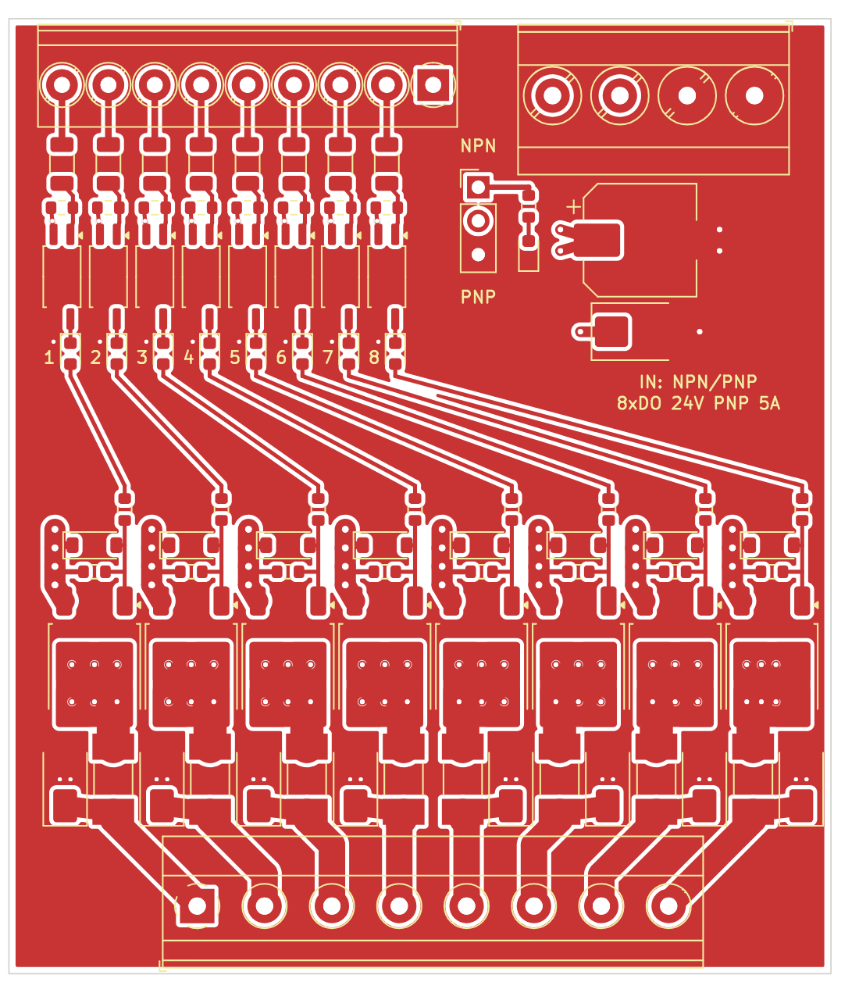

# 8 Kanal 24 V PNP MOSFET Çıkış Kartı (NPN/PNP girişli, DIN ray)

PLC / kontrol kartı çıkışlarını yükselten, opto-izoleli 8 kanallı high-side
(PNP, kaynak tipi) MOSFET kartı. Her giriş kendi çıkışını sürer; kartta işlemci yoktur.



## Özellikler

| | |
|---|---|
| Besleme | 24 V DC (19–30 V) |
| Çıkış | 8 × 24 V PNP, kanal başına 5 A sürekli |
| Toplam akım | 20 A (70 µm / 2 oz bakır ile); 35 µm bakırda 12 A ile sınırlayın |
| Giriş | 8 × 24 V, JP1 ile NPN veya PNP; ~3,7 mA @ 24 V, açma eşiği yaklaşık 7–9 V |
| İzolasyon | Giriş–çıkış arası optokuplör (JP1 takılı değilken ve `COM` ayrı beslenirken) |
| Koruma | Kanal başına 7 A hızlı SMD sigorta, serbest geçiş diyodu, kapı zeneri; beslemede TVS |
| Gösterge | Kanal başına yeşil LED (kapı sürülürken yanar), mavi besleme LED'i |
| PCB | 62 × 72 mm, 2 katman, tek yüz SMD dizgi |
| Montaj | 72 mm PCB genişliğine uygun DIN ray taşıyıcı (UM72 tipi profil); rayda 62 mm yer kaplar |
| Anahtarlama | Aç/kapa kullanım, en fazla ~20 Hz (PWM için uygun değildir) |

## Bağlantı

- **J3 (üst sağ):** soldan sağa `+24V +24V 0V 0V`. Toplam akım 12 A'yı geçiyorsa iki `+24V` kutbunu da kullanın.
- **J1 (üst sol):** soldan sağa `IN1 … IN8, COM`.
- **J2 (alt):** soldan sağa `OUT1 … OUT8`. Yük `OUTn` ile 0 V arasına bağlanır.
- **JP1:**
  - 1-2 (üst): **NPN** giriş — `COM` = +24 V, giriş 0 V'a çekilince kanal açılır.
  - 2-3 (alt): **PNP** giriş — `COM` = 0 V, girişe +24 V gelince kanal açılır.
  - Jumper yok: `COM` klemensine harici ortak uç bağlanır, giriş tarafı tam izole olur.

## Kanal devresi

```
IN ─ 4k7 ─┬─ opto LED (çift yönlü) ─ COM        +24V ─┬─ 10k ─┬─ ZD 15V ─┐
          └─ 1k ────────────────────┘                 │       │          │
                                                      S     kapı ────────┘
 opto C ─ LED ─ 10k ─ kapı        opto E ─ 0V       P-MOSFET
                                                      D ─ sigorta 7A ─┬─ OUT
                                                                      └─ SS36 ─ 0V
```

24 V'ta kapı gerilimi yaklaşık −11 V olur. SUD50P06-15 için iletim direnci en fazla
15 mΩ (25 °C); 5 A'da kanal başına yaklaşık 0,4–0,6 W ısı çıkar.

## Dosyalar

| Dosya | İçerik |
|---|---|
| `mosfet8.kicad_pro / .kicad_sch / .kicad_pcb` | KiCad 7 projesi (şema + PCB) |
| `mosfet8-schematic.pdf` | Şema çıktısı |
| `bom.csv` | Malzeme listesi (18 kalem, 88 parça) |
| `gerber/` | Gerber, delik (Excellon) ve dizgi konum dosyaları |
| `docs/` | PCB önizleme görselleri |
| `scripts/` | Şemayı ve PCB'yi üreten betikler |

Tasarım `scripts/design.py` içindeki tek bir bağlantı tablosundan üretilir. Yeniden üretmek için
(KiCad 7 kurulu Linux'ta):

```bash
cd scripts
python3 gen_sch.py && /usr/bin/python3 gen_pcb.py && python3 gen_bom.py
```

KiCad'de elle düzenleme yaparsanız betikleri tekrar çalıştırmayın; dosyaların üzerine yazar.

## Doğrulama durumu

- Şemadan çıkarılan netlist, bağlantı tablosuyla birebir eşleşiyor (60 net, 88 parça).
- KiCad 7.0.11 DRC: açıklık, kısa devre ve bağlanmamış pad hatası yok. Kalan 88 uyarı,
  betiğin çalıştığı ortamda kılıf kütüphane tablosu olmamasından kaynaklanır.
- ERC çalıştırılmadı (KiCad 7 komut satırında yok); projeyi açınca bir kez ERC çalıştırın.
- **Prototip üretilmedi ve test edilmedi.** Isıl değerler hesap tahminidir.

## Üretimden önce kontrol edilecekler

1. **Parça numaraları** hafızadan yazıldı. Siparişten önce datasheet'ten kılıf, pin sırası ve
   değerleri doğrulayın; özellikle Q (DPAK: 1 = G, tab = D, 3 = S) ve optokuplör (SO-4: 1-2 LED, 3 = E, 4 = C).
2. **Bakır kalınlığı:** 70 µm (2 oz) sipariş edin. 35 µm ile toplam akımı 12 A'da tutun.
3. **Kısa devre:** MOSFET'in kendi akım sınırlaması yoktur; koruma sigortaya ve güç kaynağının
   akım sınırına dayanır. Sigorta atınca değiştirilmesi gerekir (lehimli).
4. **Kanal LED'i** kapının sürüldüğünü gösterir; sigorta atmışsa LED yanar ama çıkış gelmez.
5. **Taşıyıcı:** PCB'de montaj deliği yoktur; kenardan tutan profil taşıyıcı varsayıldı.
   Seçtiğiniz taşıyıcının kenar payını (kenarda en yakın parça ~0,9 mm) kontrol edin.
6. **Klemensler** Phoenix PT 1,5 (3,5 mm) ve MKDS (5,08 mm) ayak izleridir; muadil kullanacaksanız
   ayak aralığı ve pin çapını karşılaştırın.
